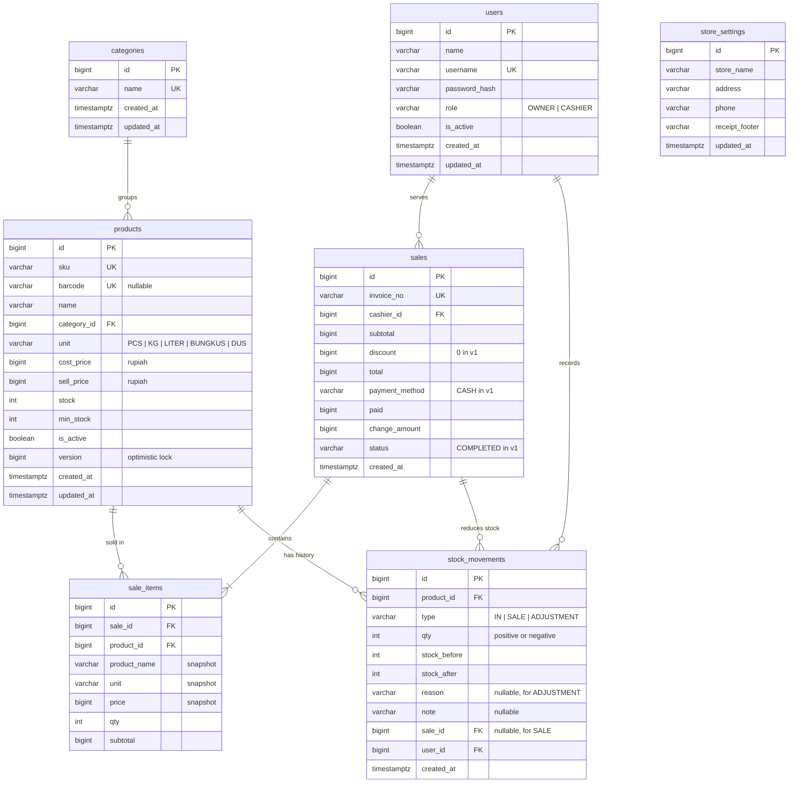

# PRD — ePOS Toko Kelontong (v1)

**Document version:** 1.2 (data model & design status)
**Document focus:** Frontend UI/UX design and data model
**Platform:** Web app (Angular + PrimeNG), separate backend (Spring Boot REST API)
**UI language:** Bahasa Indonesia

> Note on language: this document is in English, but all text shown to end users (labels, buttons, placeholders, messages, sample data) is deliberately kept in Bahasa Indonesia, in quotes or as-is.

---

## 1. Product Summary

ePOS is a web-based point-of-sale app for small-to-medium grocery stores (toko kelontong). Its main goal is to make checkout **fast, low on clicks, and low on calculation errors**, while helping the store owner monitor stock and daily revenue.

Version 1 is intentionally simple and will be expanded in stages (discounts, returns, members, QRIS, multi-branch, offline mode).

## 2. Problems Solved

- Cashiers calculate by hand or with a calculator, prone to wrong totals and change.
- The owner does not know which items are running low until a customer asks.
- There is no tidy record of daily revenue.
- Prices change often and cashiers forget the latest price.

## 3. Users (Personas)

### 3.1 Cashier — "Rina", 22 years old

- Stands at the cashier desk, often serving queues at peak hours.
- Uses a USB barcode scanner and keyboard; rarely uses the mouse when busy.
- Needs: find items fast, clearly visible total, change calculated instantly, printed receipt.
- Does not need access to cost prices or reports.

### 3.2 Store Owner — "Pak Budi", 45 years old

- Checks the store in the afternoon/evening, sometimes from a tablet.
- Needs: add/edit products and prices, record incoming stock, see today's revenue and items running low.
- Medium tech literacy: needs a clear interface, not full of technical terms.

## 4. Goals & Success Metrics

| Goal              | Indicator                                                                           |
| ----------------- | ----------------------------------------------------------------------------------- |
| Fast transactions | One 5-item transaction completed in < 30 seconds without a mouse                    |
| Few errors        | Total, change, and stock calculated by the system; validation when payment is short |
| Controlled stock  | Items below minimum stock are visible on the dashboard                              |
| Easy to learn     | A new cashier can transact without lengthy training                                 |

## 5. v1 Scope

**Included:**

- Login with roles (Owner, Cashier)
- Cashier (POS) screen: search/scan items, cart, cash payment, receipt
- Product & Category management
- Incoming Stock & Stock Adjustment
- Transaction History & receipt detail
- Concise dashboard (today's revenue, transaction count, low stock)

**Not included (roadmap):**

- Per-item discounts, returns/void transactions (v2)
- Suppliers & purchasing, profit reports (v2)
- Members & points, QRIS/non-cash, Excel/PDF export (v3)
- Multi-branch, offline mode (v4)

> Note for design: leave room/patterns so roadmap features can be added without reworking the layout (for example, the payment method area can hold options other than cash).

## 6. Access Rights

| Feature                     | Owner  | Cashier                   |
| --------------------------- | ------ | ------------------------- |
| Cashier Screen              | ✓      | ✓                         |
| Transaction History         | All    | Own only, today only      |
| Products & Categories       | Manage | View only (no cost price) |
| Incoming Stock / Adjustment | ✓      | —                         |
| Dashboard                   | ✓      | —                         |

Menus that are not permitted are **hidden**, not merely disabled.

## 7. Visual Design Direction

- **Character:** clean, functional, firm, friendly. Should feel like a work tool, not an entertainment app.
- **Density:** the Cashier Screen uses large, high-contrast elements; admin pages (products, reports) may be denser.
- **Color:** one firm primary color for the main action (the Pay button), neutral colors for the background, plus semantic colors: green (success/change), yellow/orange (low stock), red (error/payment short/delete).
- **Typography:** a highly readable sans-serif. Monetary figures use tabular numerals (equal width) so price columns align.
- **Mode:** supports light and dark.
- **Icons:** consistent, simple line style.
- **Number format:** Rupiah without decimals, dot as thousands separator — for example `Rp 125.500`.
- **Date format:** `16 Sep 2026, 14:32`.

### Target screens & devices

The app is responsive and can be opened on laptop, tablet, and phone. Reference sizes:

- **Laptop/desktop:** 1366×768 and 1920×1080
- **Tablet:** 1024×768 (landscape)
- **Phone:** 390×844

Not every screen is prioritized equally on every device; it follows who uses it:

| Screen                      | Laptop      | Tablet        | Phone               |
| --------------------------- | ----------- | ------------- | ------------------- |
| Login                       | ✓           | ✓             | ✓                   |
| Cashier (POS)               | **Primary** | ✓ (landscape) | Deferred to v2      |
| Dashboard                   | ✓           | ✓             | **Primary (Owner)** |
| Product & Category List     | ✓           | ✓             | ✓                   |
| Incoming Stock & Adjustment | ✓           | ✓             | ✓                   |
| Transaction History         | ✓           | ✓             | ✓                   |

Reason: cashiers work at the cashier desk with a laptop/tablet and barcode scanner, while the owner most often monitors the store from a phone.

### Responsive patterns

- **Tablet:** layout follows the laptop with the sidebar collapsed to icons. The Cashier Screen stays two-column, with proportions adjusted.
- **Phone:**
  - Sidebar is replaced by bottom navigation containing the main menus for the role
  - Data tables become card lists
  - Forms appear in a single column; drawers/modals appear full-screen or as a bottom sheet
  - The filter toolbar collapses into a "Filter" button that opens a bottom sheet
  - The main action button (for example "Tambah Produk") becomes a floating button or sticks to the bottom
  - Minimum touch target 44px
- If a Cashier opens the app from a phone in v1, show a friendly message that the Cashier Screen is available on laptop or tablet.

## 8. Navigation Structure

Collapsible left sidebar, top header containing the store name, user name, role, and a sign-out button.

```
- Dashboard            (Owner)
- Kasir
- Transaksi
- Produk
    - Daftar Produk
    - Kategori
- Stok                 (Owner)
    - Stok Masuk
    - Penyesuaian Stok
```

(Menu labels are the actual UI text, in Indonesian: Kasir = Cashier, Transaksi = Transactions, Produk = Products, Daftar Produk = Product List, Kategori = Categories, Stok = Stock, Stok Masuk = Incoming Stock, Penyesuaian Stok = Stock Adjustment.)

For a Cashier, after login they go straight to the Cashier Screen. For an Owner, to the Dashboard.

**Phone navigation (Owner):** bottom menu containing Dashboard, Transaksi, Produk, Stok, and Lainnya (More: Kategori, profile, sign out).

---

## 9. Screen Specifications

### 9.1 Login

**Purpose:** sign in to the app.

**Elements:**

- Logo/store name
- Username input, password input (with show/hide button)
- "Masuk" button
- Error message below the form

**States:** default, loading (button shows a spinner and is disabled), error ("Username atau password salah").

---

### 9.2 Cashier Screen (POS) — **the most important screen**

**Purpose:** complete a transaction as fast as possible.

**Layout (desktop):** two columns.

**Left column (± 60%) — Search & Cart**

- Large search input at the top, placeholder: "Scan barcode atau ketik nama barang (F2)". Always returns focus here after an item is added.
- Search results dropdown: item name, SKU, selling price, remaining stock. Navigate with up/down arrows, Enter to add.
- Cart table with columns: No, Nama Barang, Harga, Qty (− / input / + buttons), Subtotal, delete button.
- The most recently added item gets a brief highlight.

**Right column (± 40%) — Summary & Payment**

- Temporary invoice number and cashier name
- Item count
- **TOTAL** in a very large size
- Dominant "Bayar (F9)" button
- Secondary button: "Kosongkan Keranjang"

**Payment Modal (appears after Pay):**

- Purchase total (large)
- Method: Cash (the only one in v1, but shown as a choice)
- "Uang Diterima" (amount received) input with quick amount buttons: Uang Pas, 10.000, 20.000, 50.000, 100.000
- **Kembalian** (change) shown in real time, green if enough, red with the message "Uang kurang Rp X" if short
- "Selesaikan Transaksi (Enter)" button, disabled if payment is short

**After a successful transaction:**

- Confirmation view: success check mark, invoice number, total, amount paid, change
- "Cetak Struk" and "Transaksi Baru (Enter)" buttons

**Keyboard shortcuts:**

| Key    | Action                          |
| ------ | ------------------------------- |
| F2     | Focus the search                |
| F9     | Open payment                    |
| Enter  | Add item / confirm              |
| + / −  | Change qty of the selected item |
| Delete | Remove the selected item        |
| Esc    | Close modal                     |

Show a subtle shortcut hint at the bottom of the screen.

**States & special cases:**

- Empty cart: simple illustration + text "Scan atau cari barang untuk memulai"
- Barcode not found: notification "Barang dengan barcode 8991234567890 tidak ditemukan"
- Insufficient stock: qty cannot exceed stock, warning shown "Stok Minyak Goreng 2 L tersisa 3"
- Out of stock: item appears in search results with the label "Habis" and cannot be added
- Transaction save failure (connection/server): clear error message, the cart is **not lost**, retry button
- Loading while saving the transaction: button shows a spinner, prevent double clicks

---

### 9.3 Receipt (print view)

Width format for 58 mm and 80 mm thermal printers.

**Contents:** store name, address, phone number, invoice number, date & time, cashier name, separator line, item list (name; qty × price; subtotal), separator line, total, cash, change, closing line "Terima kasih, selamat belanja kembali".

---

### 9.4 Dashboard (Owner)

**Summary cards (top row):**

- Today's revenue
- Today's transaction count
- Average transaction value
- Number of low-stock products

**Content:**

- Bar chart of today's sales per hour
- "Stok Menipis" table: item name, current stock, minimum stock, "Tambah Stok" button (goes to Incoming Stock with the item preselected)
- "5 Barang Terlaris Hari Ini" table: name, qty sold, total

**State:** no transactions today → cards show 0 and a friendly message, not a confusing empty chart.

---

### 9.5 Product List

**Toolbar:** search (name/SKU/barcode), category filter, status filter (Aktif/Nonaktif/Stok Menipis), "Tambah Produk" button.

**Table:** SKU, Nama, Kategori, Harga Jual, Harga Modal (Owner only), Stok (orange badge if low, red if out), Status, Aksi (Edit, Nonaktifkan).

Pagination at the bottom. Supports sorting per column.

**Add/Edit Product Form (side drawer or modal):**

- Nama barang*, SKU*, Barcode (optional, with a scan icon), Kategori*, Satuan* (pcs, kg, liter, bungkus, dus)
- Harga Modal*, Harga Jual* — show automatic margin ("Margin Rp 1.500 / 12%"); warning if selling price is below cost
- Stok Awal (only when adding), Stok Minimum*
- Active toggle
- Inline per-field validation

**States:** empty ("Belum ada produk. Tambahkan produk pertama Anda"), empty search result, loading (table skeleton).

---

### 9.6 Categories

Simple table: Nama Kategori, Jumlah Produk, Aksi (Edit, Hapus). Add/edit via a small modal. Delete is blocked if the category still has products, with an explanation.

---

### 9.7 Incoming Stock (Owner)

- Select/scan an item, enter quantity, note (e.g. "Belanja grosir 16 Sep")
- Can add several items in one entry (temporary list)
- Show stock before → after for each item
- "Simpan Stok Masuk" button
- Below it: recent incoming stock history

### 9.8 Stock Adjustment (Owner)

- Select an item, show the current system stock
- Enter the physical stock counted; the difference is calculated automatically (+/−)
- Reason required: Rusak, Kedaluwarsa, Hilang, Salah Hitung, Lainnya
- Confirmation before saving

---

### 9.9 Transaction History

**Filters:** date range (default today), cashier (Owner only), invoice number search.

**Summary above the table:** total revenue and transaction count according to the filter.

**Table:** No. Invoice, Tanggal & Jam, Kasir, Jumlah Item, Total, Aksi (Lihat).

**Transaction Detail (drawer/modal):** looks like a receipt with a "Cetak Ulang" button.

---

## 10. Reusable Components

- Buttons (primary, secondary, danger, icon) with loading & disabled states
- Text input, Rupiah number input (auto thousands formatting), qty stepper input, dropdown, date range picker
- Data table with pagination, sorting, skeleton loading
- Stock status badge (Aman / Menipis / Habis) and product status (Aktif / Nonaktif)
- Statistic card
- Modal, side drawer, confirmation dialog
- Toast notifications (success, warning, error)
- Empty state with a light illustration and call to action

## 11. Accessibility & Comfort

- All flows on the Cashier Screen can be completed with the keyboard alone
- Keyboard focus is clearly visible
- Text contrast meets WCAG AA
- Color is never the only status indicator (always accompanied by text/icon)
- Minimum click target 40px on the Cashier Screen (comfortable for touch screens)

## 12. Sample Data for Mockups

**Store:** Toko Berkah Jaya — Jl. Kaliurang Km 5, Yogyakarta

| SKU     | Name               | Category        | Selling Price | Stock | Min Stock |
| ------- | ------------------ | --------------- | ------------- | ----- | --------- |
| BRS-005 | Beras Premium 5 kg | Sembako         | Rp 78.000     | 24    | 10        |
| MYK-002 | Minyak Goreng 2 L  | Sembako         | Rp 36.500     | 3     | 12        |
| GLA-001 | Gula Pasir 1 kg    | Sembako         | Rp 17.500     | 40    | 15        |
| TLR-001 | Telur Ayam 1 kg    | Sembako         | Rp 29.000     | 8     | 10        |
| MIE-001 | Mi Instan Goreng   | Makanan         | Rp 3.500      | 120   | 48        |
| AIR-600 | Air Mineral 600 ml | Minuman         | Rp 4.000      | 0     | 24        |
| SBN-001 | Sabun Mandi Batang | Kebutuhan Rumah | Rp 4.500      | 36    | 12        |
| KPI-001 | Kopi Sachet        | Minuman         | Rp 2.000      | 85    | 30        |

**Sample cart:** Beras Premium 5 kg ×1, Mi Instan Goreng ×5, Telur Ayam 1 kg ×1, Kopi Sachet ×10 → **Total Rp 144.500**, amount received Rp 150.000, change **Rp 5.500**.

**Users:** Budi Santoso (Owner), Rina Lestari (Cashier).

## 13. Design Status

The v1 design is **complete** in Claude Design, done one screen per request in the following order (all laptop screens first, other devices last):

| Step | Screen                                                                                   | Device           | Status |
| ---- | ---------------------------------------------------------------------------------------- | ---------------- | ------ |
| 1    | Cashier Screen: filled cart — visual style is locked here                                | Laptop           | Done   |
| 2    | Cashier Screen: payment modal, success screen, payment-short & insufficient-stock states | Laptop           | Done   |
| 3    | Dashboard                                                                                | Laptop           | Done   |
| 4    | Product List + add/edit form                                                             | Laptop           | Done   |
| 5    | Transaction History + receipt detail                                                     | Laptop           | Done   |
| 6    | Incoming Stock, Stock Adjustment, Categories                                             | Laptop           | Done   |
| 7    | Login, 58 mm receipt, design tokens page                                                 | Laptop           | Done   |
| 8a   | Cashier Screen                                                                           | Tablet landscape | Done   |
| 8b   | Dashboard, Product List, Transaction History, Login                                      | Phone            | Done   |

**Not yet made (to follow if needed):**

- Tablet mockups for screens other than Cashier — just follow the responsive patterns in section 7 during implementation.
- Phone versions of Incoming Stock, Stock Adjustment, and Categories — follow the phone patterns in section 7.
- Dark mode variants.
- Phone version of the Cashier Screen — deferred to v2.

---

## 14. Data Model

### 14.1 Entity Relationship Diagram (ERD)



### 14.2 Table-to-Screen Mapping

| Table             | Used in screen                                                                  |
| ----------------- | ------------------------------------------------------------------------------- |
| `users`           | Login (9.1), header & cashier name, cashier filter in Transaction History (9.9) |
| `categories`      | Categories (9.6), filter & form in Products (9.5)                               |
| `products`        | Cashier (9.2), Products (9.5), Low Stock on Dashboard (9.4), Stock (9.7–9.8)    |
| `stock_movements` | Incoming Stock & its history (9.7), Stock Adjustment (9.8)                      |
| `sales`           | Cashier (9.2), Dashboard (9.4), Transaction History (9.9)                       |
| `sale_items`      | Receipt (9.3), transaction detail (9.9), Best Sellers on Dashboard (9.4)        |
| `store_settings`  | Receipt header (9.3), store name in the app header                              |

### 14.3 Enum Values

| Column                   | v1 values                                                   | Prepared for roadmap  |
| ------------------------ | ----------------------------------------------------------- | --------------------- |
| `users.role`             | `OWNER`, `CASHIER`                                          | —                     |
| `products.unit`          | `PCS`, `KG`, `LITER`, `BUNGKUS`, `DUS`                      | —                     |
| `stock_movements.type`   | `IN`, `SALE`, `ADJUSTMENT`                                  | `RETURN`, `VOID` (v2) |
| `stock_movements.reason` | `RUSAK`, `KEDALUWARSA`, `HILANG`, `SALAH_HITUNG`, `LAINNYA` | —                     |
| `sales.payment_method`   | `CASH`                                                      | `QRIS`, etc. (v3)     |
| `sales.status`           | `COMPLETED`                                                 | `VOIDED` (v2)         |

Enums are stored as `varchar` with a `CHECK` constraint (not a PostgreSQL enum type) so they map easily with `@Enumerated(EnumType.STRING)` in JPA and are easy to change through Flyway migrations.

### 14.4 Data Rules

- **Money:** all amounts are stored as `bigint` in rupiah, no decimals. No floating-point types.
- **Stock:** `stock_movements` is the source of truth and audit trail; `products.stock` is a cache that is always updated in the same transaction. Stock must not be negative (`CHECK (stock >= 0)`).
- **Transaction snapshot:** `sale_items` stores the name, unit, and price at the time of the transaction, so history stays accurate even if product data changes.
- **Sales integrity:** creating a transaction (insert `sales` + `sale_items`, reduce stock, record `stock_movements`) runs in a single database transaction with row locking on products. The total is recalculated on the server, not taken from the frontend.
- **No hard deletes:** products and users are deactivated via `is_active`. Foreign keys to `products` and `users` use `ON DELETE RESTRICT`. A category can only be deleted if it has no products (section 9.6).
- **Invoice number:** unique, format `INV-YYYYMMDD-NNNN` (example `INV-20260916-0001`), sequence resets every day.
- **Time zone:** time is stored as `timestamptz`; display and daily reports use the Asia/Jakarta zone.
- **Additional indexes:** `products(name)` for search at the cashier, `sales(created_at)` for daily reports and history, `stock_movements(product_id, created_at)` for per-item history.
